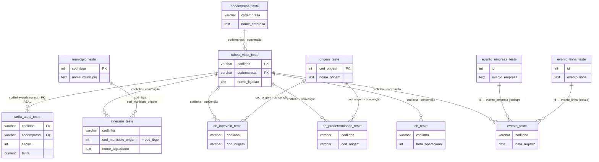

# Relação das Tabelas — Portal DIVAT (`divat - TESTE`)

Mapa **relacional** do banco: como as tabelas se ligam entre si, por qual chave, e se a
ligação é uma **FK real** (garantida pelo banco) ou uma **convenção** (join feito no código
do `app.js`, sem constraint no banco). Complementa a tabela *"Tabelas → onde aparecem
(cards)"* do `CLAUDE.md`, que é o mapa **funcional** (qual tela lê qual tabela).

> **Por que este arquivo existe:** quase todas as ligações deste banco são **implícitas** —
> só **uma FK é declarada** (`fk_tarifa_linha`). O resto do "esquema" vive espalhado dentro
> dos `loader()` do `app.js`. Este doc torna isso explícito, para reconstrução de dados,
> conferência e para qualquer sessão futura (humana ou IA) entender os joins sem reler ~3,2
> mil linhas de JS. Gerado do schema **ao vivo** (Supabase) + os joins reais do frontend.

> **⚠ Ligação implícita não é ligação garantida — e já falhou.** Como o Postgres não valida
> essas ligações, a integridade depende só da disciplina do ETL. Medição de 27/07/2026: **17
> `codlinha` órfãs** (filhos em `itinerario_teste`, `qh_teste`, `qh_predeterminado_teste` e
> `evento_teste` apontando para linha que não existe no hub) + **4 linhas** com `cod_origem`
> inexistente. Quando isso acontece o portal **não avisa: a tela sai vazia, sem erro.** O alarme
> é `scripts/check_data_quality.mjs` (diário, workflow `db-checks.yml`) e a dívida atual está
> registrada em `scripts/data_quality_baseline.json`. Ver `CLAUDE.md` §2e.

O alvo vigente é `gontnlfmothfglssbyyk`, banco oficial em uso; a antiga produção
foi apagada segundo o dono. Dados privados de importação e conciliação integram o estado a
preservar. A recuperação integral segue [backup.md](backup.md), por dump consistente.

## Visão geral — hub-and-spoke

`tabela_vista_teste` (cadastro de linhas) é o **hub**. Praticamente tudo se liga a ela por
**`codlinha`**. Em volta há tabelas-fato (itinerário, quadros, tarifa, frota, eventos) e
tabelas-dimensão/lookup (empresa, origem, município).

## Relações — detalhe

### Hub
| Tabela | PK | Papel |
|---|---|---|
| `tabela_vista_teste` | (`codlinha`, `codempresa`) | Cadastro de linhas. **Hub** — origem do `codlinha` que amarra tudo. |

### Fatos (ligam ao hub por `codlinha`)
| Tabela | Chave de join → hub | Tipo | Onde no código |
|---|---|---|---|
| `tarifa_atual_teste` | `codlinha` (+`codempresa`) | **FK REAL** `fk_tarifa_linha` | `renderTarifas`, `renderFolhaRosto`, `renderLinhaQuadro` |
| `itinerario_teste` | `codlinha` | convenção | `renderItinerarios` (`src/documentos/frota-historico-itinerarios.mjs`) |
| `qh_intervalo_teste` | `codlinha` | convenção | `fetchQHByLines`, `renderLinhaQuadro` |
| `qh_predeterminado_teste` | `codlinha` | convenção | `fetchQHByLines`, `renderLinhaQuadro` |
| `qh_teste` (frota) | `codlinha` | convenção | `renderFrota` (`src/documentos/frota-historico-itinerarios.mjs`), folha de rosto |
| `evento_teste` | `codlinha` | convenção | `renderLineHistory` (`src/documentos/frota-historico-itinerarios.mjs`), pesquisa de evento |

> **`fk_tarifa_linha` é composta e "cruzada":** a constraint declara os dois pares
> (`codlinha`↔`codlinha` e `codempresa`↔`codempresa`) contra a PK `(codlinha, codempresa)`
> de `tabela_vista_teste`. É a **única** integridade referencial garantida pelo banco; todo o
> resto depende dos dados virem consistentes do ETL do dono.

### Dimensões / lookups
| Tabela | PK | Ligada de | Por | Tipo |
|---|---|---|---|---|
| `codempresa_teste` | `id`; `codempresa` único **por convenção do ETL** (índice btree não-UNIQUE `idx_codempresa_codempresa` — o banco NÃO garante) | `tabela_vista_teste`, `qh_teste`, `evento_teste`, `itinerario_teste` | `codempresa` | convenção — resolve nome da empresa (`empNome`/`getEmpresas`) |
| `origem_teste` | `cod_origem` | `qh_intervalo_teste` (`cod_origem`), `qh_predeterminado_teste` (`cod_origem`) | `cod_origem` | convenção — nome do terminal/origem (`origemMap`) |
| `municipio_teste` | `cod_ibge` | `itinerario_teste` (`cod_municipio_origem`) | `cod_ibge` | convenção — nome do município (`ibgeMap`/`getIbge`) |
| `evento_empresa_teste` | `row_id` (`id`) | `evento_teste` | `id` | convenção — descrição do evento de empresa (`getEvLookups`→`evLookups.emp`) |
| `evento_linha_teste` | `row_id` (`id`) | `evento_teste` | `id` | convenção — descrição do evento de linha (`getEvLookups`→`evLookups.lin`) |
| `localidades_teste` | `ordem_importacao` | — (lista de referência) | texto | convenção — "Linhas por Localidade e Município" |
| `portaria_teste` | `id` | — (documento independente) | — | legislação/portarias · tem o trigger `trg_vigor_auto` (ver "Funções e trigger") |

## ⚠️ Armadilhas de nomenclatura (não confundir)

- **`cod_origem` (terminal) × `cod_municipio_origem` (município) — desambiguado em 17/07/2026:**
  - Em `qh_intervalo_teste` e `qh_predeterminado_teste` → `cod_origem` = **terminal/origem** →
    `origem_teste`. (O typo histórico `cod_origen`, com N, em `qh_intervalo_teste` foi **corrigido**
    para `cod_origem` na mesma mudança.)
  - Em `itinerario_teste` → a coluna que antes se chamava `cod_origem` foi **renomeada** para
    **`cod_municipio_origem`** (tipo `int`): **NÃO é terminal** — o código faz
    `ibge[r.cod_municipio_origem]`, ou seja, é um **código de município (IBGE)** → `municipio_teste`
    (ver `renderItinerarios`, em `src/documentos/frota-historico-itinerarios.mjs`, e
    `classifyMunLines`, em `src/domain/agrupamento.mjs`).
- **`codlinha` e `codempresa` são strings** (`varchar`), não inteiros — comparar/encodar
  como texto nas queries.
- **`nome_origem` vem denormalizado e às vezes trocado** nas tabelas de QH; o código dá
  prioridade ao nome autoritativo de `origem_teste` (ver comentário em `quadroHorariosBodyHTML`).

## Tabelas de staging do ETL (o portal NÃO lê)

Alimentam as tabelas finais via service role (painel Supabase). Têm RLS ligado **sem policy**
e sem grant para `anon`/`authenticated` → invisíveis pela API pública, de propósito. O lint
`rls_enabled_no_policy` nelas é **esperado**.

| Staging | Junta com | Por | Monta a final |
|---|---|---|---|
| `evento_dados` | `evento_textos` | `id` | → `evento_teste` |
| `portaria_data` | `portaria_texto_teste` | `id` | → `portaria_teste` |

## Funções e trigger (schemas `public`, `private` e `audit`)

A migração `20260729034018_phase3_moderate_hardening.sql`, aplicada primeiro no projeto de teste,
separa produto, implementação e diagnóstico:

- `public`: duas RPCs de produto anônimas;
- `private`: `f_unaccent(text)` e `fn_vigor_auto()`, fora da Data API;
- `audit`: quatro diagnósticos executáveis somente por `divat_auditor`.

As funções de `audit` são `SECURITY DEFINER`, com `search_path` fixo e owner
`divat_audit_owner` (`NOLOGIN`, sem bypass RLS e herdando só a leitura de `anon`). Isso permite
ao auditor produzir o mesmo retrato público sem receber `SELECT` direto nas tabelas.

| Função | Schema | Quem chama |
|---|---|---|
| `divat_busca_logradouro(termo, p_ibge?)` | `public` | front anônimo — Ligações por Logradouro |
| `divat_linhas_regiao(p_regiao, p_modo)` | `public` | front anônimo — Linhas por Região e Município |
| `divat_data_quality()` | `audit` | credencial PostgreSQL auditora |
| `divat_api_shape()` | `audit` | credencial PostgreSQL auditora |
| `divat_security_shape()` | `audit` | credencial PostgreSQL auditora |
| `divat_security_digest()` | `audit` | credencial PostgreSQL auditora |
| `realtime_tables()` | `audit` | credencial PostgreSQL auditora |
| `f_unaccent(text)` | `private` | implementação de `divat_busca_logradouro` |
| `fn_vigor_auto()` | `private` | trigger `trg_vigor_auto` |

> `public.rls_auto_enable()` e o event trigger `ensure_rls` ligam RLS em tabelas públicas
> novas. A exceção `SECURITY DEFINER` foi revisada; não concede acesso público e não substitui
> RLS explícito/revokes nas migrations. Regras em [seguranca.md](seguranca.md), § 9.4.

**Trigger de produto:** `trg_vigor_auto` em `portaria_teste`, `BEFORE INSERT OR UPDATE`, executa
`private.fn_vigor_auto()`. Os triggers de `realtime` e `storage` são gerenciados pela plataforma.

`docs/backup_schema.sql` é uma baseline histórica pré-Fase 3, insuficiente para reconstruir o
estado atual. Não executá-la junto de um `pg_restore` completo. Migrations posteriores têm
pré-requisitos de schema e dados; copiar seu histórico não recupera snapshots antigos.

## Contagem de linhas (referência — snapshot 15/07/2026)

| Tabela | Linhas | | Tabela | Linhas |
|---|--:|---|---|--:|
| `itinerario_teste` | 52.146 | | `qh_intervalo_teste` | 9.598 |
| `qh_predeterminado_teste` | 23.838 | | `tarifa_atual_teste` | 3.488 |
| `evento_teste` | 20.753 | | `portaria_teste` | 2.100 |
| `tabela_vista_teste` | 1.869 | | `qh_teste` | 1.490 |
| `localidades_teste` | 752 | | `origem_teste` | 548 |
| `codempresa_teste` | 133 | | `municipio_teste` | 92 |
| `evento_linha_teste` | 82 | | `evento_empresa_teste` | 51 |

## Recuperação conferida — 03/10/2026

Antes desta operação, leituras como `postgres` (sem RLS) e como `anon` confirmaram três
tabelas vazias. A migration `20261003115732_recover_empty_itinerary_and_timetables.sql`
restaurou o snapshot público de 28/09 de `bkp_divat_teste_20260928_1944`, preservando
`row_id` e reiniciando suas sequências. `EXCEPT ALL` nos dois sentidos confirmou conteúdo
idêntico, inclusive multiplicidades. As outras 16 tabelas públicas mantiveram as contagens.
As colunas atuais `observacao` e `bairro` de itinerários foram preservadas, nulas: o snapshot
não as continha. Não houve integração de alterações do Access bruto nesta recuperação.

| Tabela pública | Registros conferidos como `postgres` e `anon` |
|---|--:|
| `codempresa_teste` | 133 |
| `evento_empresa_teste` | 51 |
| `evento_linha_teste` | 83 |
| `evento_teste` | 20.901 |
| `itinerario_teste` | 52.385 |
| `localidades_teste` | 751 |
| `municipio_teste` | 92 |
| `origem_teste` | 549 |
| `portaria_teste` | 2.140 |
| `qh_intervalo_teste` | 9.553 |
| `qh_predeterminado_teste` | 25.748 |
| `qh_teste` | 1.495 |
| `tabela_vista_teste` | 1.885 |
| `tarifa_atual_teste` | 3.497 |
| `tarifa_promocional_exibicao_teste` | 1.000 |

## Limpeza dos schemas antigos — 03/10/2026

A migration `20261003205009_drop_verified_legacy_duplicate_schemas.sql` removeu somente
`codex_backup_20260924`, `bkp_divat_teste_20260928_1944` e `codex_import_20260924`.
Antes da aplicação e dentro da migration foram verificadas dependências transitivas em
`pg_depend`, views/regras/FKs, corpos/configurações de funções, publicações e cron.
Nenhuma referência externa foi encontrada; `cron.job` não existia. A migration aborta com
`RAISE EXCEPTION` caso alguma dessas condições mude, e limita espera por locks e execução.

Após a recuperação, o banco tinha **642.444.435 bytes**; após a limpeza, **438.037.651 bytes**
(612,7 → 417,7 MiB; redução de 194,9 MiB). Os três schemas estão ausentes. As 19 tabelas
públicas conservaram suas contagens, as 15 leituras `anon` foram conferidas e o Realtime
permanece com as mesmas tabelas. RLS continua nas 19, sem escrita pública nem SELECT de
`authenticated`. As 16 tabelas de integração/histórico/Access preservaram suas contagens.

Permanecem `public`, `divat_integracao`, `divat_historico`, `audit`, `private` e
`stage_access_20260928`, além dos schemas gerenciados pelo Supabase. A FK de
`divat_integracao.memo_texto_origem` para `stage_access_20260928.source_record` permanece.
O dono autorizou essa operação sem executar o novo backup externo; isso não comprova DR.

## Integração incremental do Access — 29/09/2026

No projeto TESTE (`gontnlfmothfglssbyyk`), a exportação de 28/09/2026 está preservada
em `stage_access_20260928`: 43 tabelas e 209.004 registros. Os modelos privados abaixo
mantêm chave de página/slot, hash do registro e os valores originais; não são fontes de
atos vigentes por si sós. Todas as tabelas novas têm RLS, sem policies nem grants públicos.
O schema `divat_integracao` não concede `USAGE` a `anon` ou `authenticated`.

| Tabela em `divat_integracao` | Registros | Papel |
|---|--:|---|
| `qh_operacional_origem` | 1.495 | Frota, processo, picos e valores brutos de tempo de viagem; unidade ainda não confirmada |
| `itinerario_alteracao_origem` | 1.618 | Registro da alteração na origem; não substitui o itinerário publicado |
| `qh_fragmento_origem` | 35.301 | Intervalos e partidas; preserva IDs fracionários da origem |
| `referencia_auxiliar_origem` | 2.208 | Características e nomes de ligação da origem |
| `memo_texto_origem` | 2 | Textos externos recuperados do ACCDB, com ponteiro, hash e tamanho |
| `campo_invalido_origem` | 2 | Valores inválidos de `PicoManhaFim`; JSON original preservado e campo tipado nulo |
| `evento_importacao_conciliacao` | 4 | Três eventos novos e uma divergência de data ainda sem confirmação documental |
| `atualizacao_auditoria_20260929` | 6 | Antes/depois das três inclusões, duas observações e marcação da data suspeita |
| `tarifa_promocional_conciliacao_20260929` | 390 | Classificação privada das promoções sem seção atual; códigos e versões históricas preservados sem confirmar vigência |

A migração `20260929214137_tarifa_promocional_conciliacao_privada.sql` registra um
snapshot privado das 390 promoções não exibidas: 333 códigos apontam, pelo prefixo,
para linhas sem seções tarifárias atuais; uma seção 00 e outras 56 seções não existem
no cadastro tarifário dessas linhas. Todas as 390 seções aparecem nas versões
históricas, mas isso não comprova vigência. Somente três têm o mesmo valor promocional
em alguma versão. A seção `13500100400` tem dois vínculos históricos (`135001003` e
`135001004`), registrados como divergência. Nenhuma associação foi escolhida por
inferência. RLS ligado, sem policies/grants públicos; não é lida pelo portal nem
participa do Realtime. O prefixo do código é uma referência para conciliação, não
uma ligação confirmada. O snapshot não substitui os registros brutos e não atualiza
automaticamente quando o cadastro muda.

As migrações `20260929201822_access_complementos_e_proveniencia_20260929.sql` e
`20260929202229_access_anomalias_origem_20260929.sql` definem essas estruturas. As cargas
guardadas estão em `scripts/integrate_access_complementos.sql` e
`scripts/integrate_access_eventos_observacoes.sql`; exigem a staging e os textos recuperados
identificados por hash, e abortam quando as contagens ou identidades não conferem.

| Tabela pública existente | Colunas acrescentadas | Leitura no portal |
|---|---|---|
| `evento_teste` | `fonte_registro text`, `conferido_documentalmente boolean`, `data_publicacao_suspeita boolean` | Histórico da linha, da empresa e pesquisa de eventos; data suspeita aparece como “Não confirmada” |
| `qh_teste` | `observacao_fonte text`, `observacao_conferida_documentalmente boolean` | Observações nos horários e na estrutura operacional, com indicação de conferência pendente |

As colunas são anuláveis para preservar os registros antigos. Não são filtradas pelos
loaders, portanto não exigem índices novos. As tabelas já pertencem à publicação Realtime
e às listas `RT_TABLES`/`VIEW_TABLES`; os modelos privados não entram nessas listas.

Os eventos 21639–21641 foram inseridos em `evento_dados`, `evento_textos` e `evento_teste`:
**20.901** registros em cada uma dessas tabelas. Somente as observações vazias dos QHs 256 e 571 foram preenchidas,
resultando em 625 observações não vazias. Os campos originais do evento 19953, inclusive
sua data de publicação divergente, ficaram preservados para conferência. Nenhuma dessas
inclusões promove automaticamente status, tarifa ou itinerário.

## Histórico aplicado no projeto em uso

O projeto `gontnlfmothfglssbyyk` tem 21 migrations registradas, conferidas em 03/10/2026.
Seus identificadores foram
conciliados com `supabase/migrations/` a partir do histórico aplicado, sem reexecutar SQL nem
alterar `supabase_migrations`. Os reparos de funções usam as versões aplicadas
`20260822144625` e `20260822151732`; as versões antigas dos nomes de arquivo não eram outras
migrations pendentes. As diferenças de texto desses dois reparos eram comentários e whitespace.

O histórico inclui schemas privados de importação, histórico cadastral, tarifas de origem,
views de conferência, `REPLICA IDENTITY FULL` e a guarda de fechamento do digest. A migration
`backup_test_before_access_import_20260924` cria cópias com `CREATE TABLE ... AS TABLE`: ela
registra uma operação passada; reaplicá-la não recupera os dados daquele snapshot.

A conciliação do histórico não torna a baseline antiga `docs/backup_schema.sql` um retrato
completo do banco atual. Migrations dependem de estrutura prévia, e dados importados fora do
DDL dependem do dump. Recuperação exige o procedimento de `docs/backup.md` e restauração
isolada; não usar `db push` no banco ativo para reaplicar o histórico recuperado.

A migration `20260930172521_fecha_authenticated_tarifa_promocional.sql` fecha o SELECT de
`authenticated` e restringe a policy promocional a `anon`, sem alterar registros. O histórico
daquela conciliação continha 18 entradas. Depois foram aplicadas a guarda de segurança
`20260930213009`, a recuperação `20261003115732` e a limpeza `20261003205009`;
não reexecutar migrations já aplicadas.
